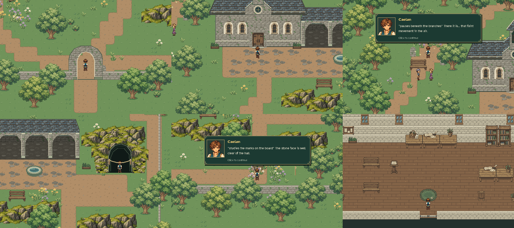
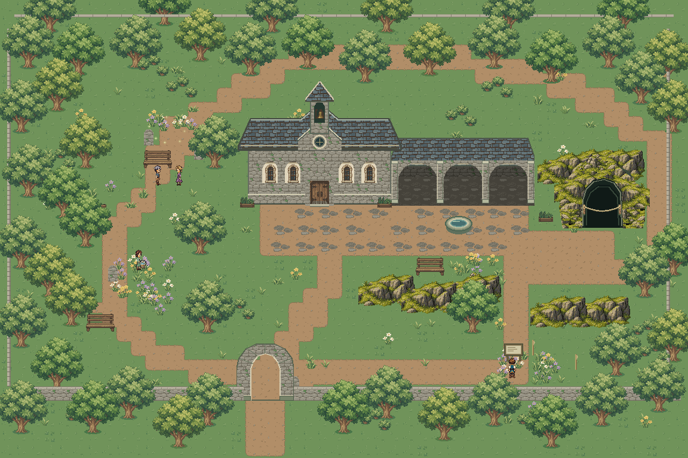

# Sanctuary pixel-asset rebuild — in-game review

[Focused ordinary gameplay](reserve_walk.mp4) · [Local map](local_map.png) · [Hall overview](hall_overview.png)

The reserve and hall are assembled from reusable native 24-pixel assets. The
full overview stitches bounded calls to the production World renderer. All
character-scale stills and the movie use the real Game with ordinary movement.
The capture walks normally from Eldenmere's southern exit, along the overworld
sanctuary approach and onto the miniature. It visits the boundary, caretaker,
grove visitors, confluence clearing, complete woodland loop, cave approach and
survey board, directly crosses grass, enters the three cloister bays and walks
behind/in front of scenery, then enters the hall and reads its observations. Transit
between demonstrations is walked normally and omitted from the focused movie. The hall
door and southern reserve exit return through production contacts.

Disposable save/continue checks resume on grass in the reserve and in the hall. The
round trip ends back in Eldenmere without changing quests, inventory, dialogue
flags, abilities or music. Solid-foot probes check the hall, cliff, cave depth,
stone seam, trees, basin, benches and boundary wall. No dungeon is implemented.

[Verification](verification.json) records actual positions, inspections, the
full 24×12-foot connectivity flood, source/artifact fingerprints and closed loop.
Player save/settings files remain untouched. Reproduce with
`python tools/capture_sanctuary_reserve.py`; verify retained evidence with
`python tools/capture_sanctuary_reserve.py --check`.

Final validation passed **192 tests and 1,949 subtests across 23 relevant suites**,
covering the reserve, hall, world travel, save compatibility, party followers,
existing quest scenes, maps and audio. Both deterministic scene builders pass
`--check`. All **16,330** clear exterior full-foot samples form one connected
region; all 22 circuit segments pass production pathfinding and actual player
movement. The hall's 2,248 clear floor samples are likewise connected. All three
cloister bays admit full player feet across five independently selected lanes.
Old clear saved positions remain exact; newly blocked historical positions
restore to a safe entry in the same scene.

Existing Eldenmere and regional source packs remain unchanged. The old reserve
and hall paintings, traced depth exports and localized repair-patch pipeline
have been removed.

Final capture validation: the **58.33-second** silent movie contains **875 frames
at 960 × 640 / 15 fps**. The complete-foot flood reaches **16,330 of 16,330**
clear samples. All ten inspections, all ten public approaches, the complete
22-anchor circuit, four direct grass crossings, three cloister entries, both
Save/Continue checks and the return to Eldenmere pass. The cave rail stops the
player at feet `(1008, 377.2)`, in front of its visible footprint.

The source/artifact checker passes independently; a deliberately stale source
fingerprint was rejected. The final full reserve, contact sheet and hall views
were visually inspected. [Tree overlap](depth_1_behind.png),
[basin overlap](depth_2_behind.png), [bench overlap](depth_3_behind.png) and
[hall plant overlap](hall_plant_behind.png) are actual ordinary-movement poses,
with matching front views alongside them in this directory.
