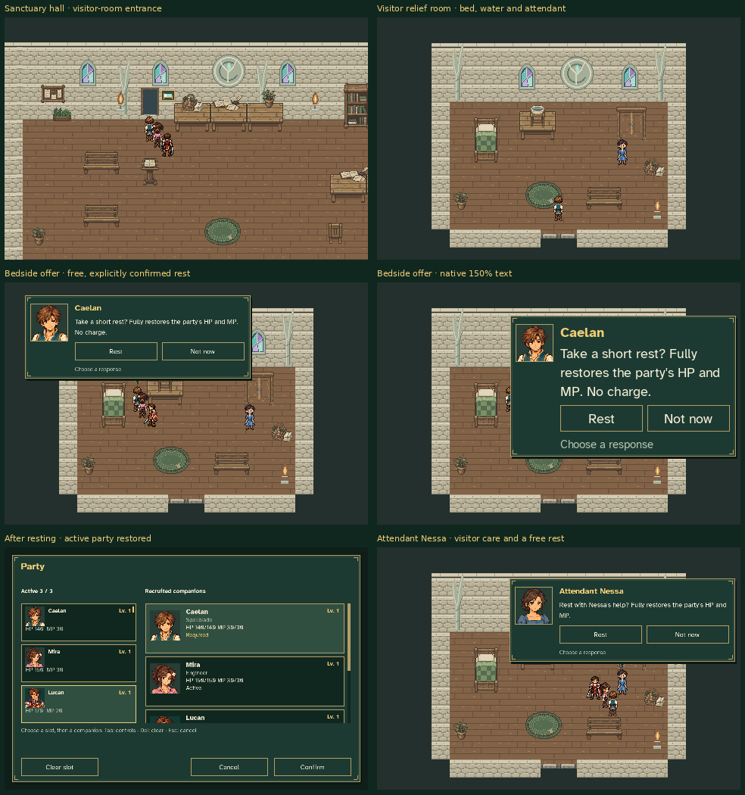

# Sanctuary visitor relief room



These captures use the production `Game`, its hall doorway, visitor-room map,
attendant, bed choices, recovery, and Party menu. The initial hall location,
recruited party and injuries are disposable review fixtures. No player save or
settings outside a temporary directory is read or changed.

The tool walks from the hall entrance to the new wing, enters by normal door
contact, then walks to the bed and Nessa. Rest is accepted through the real
choice UI. All available companions recover HP/MP, including a fallen active
member and an available reserve. An unrecruited character remains unchanged;
EXP, inventory, quest facts, cave encounter state and the score remain intact.

Six screenshots cover the hall door, room, bed offer, minimum-size 150% text,
restored party and attendant's offer. `verification.json` records the exact
fixture resources and checks. The map uses the existing native pixel packs.

Reproduce from the repository root:

```sh
SDL_VIDEODRIVER=dummy SDL_AUDIODRIVER=dummy python tools/capture_sanctuary_relief.py
```

Use `--output /tmp/sanctuary-relief-review` for disposable alternative captures.
