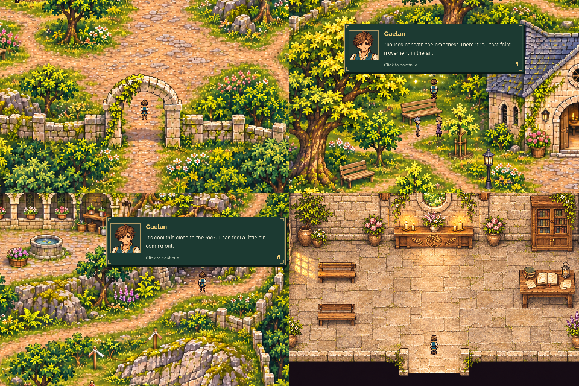
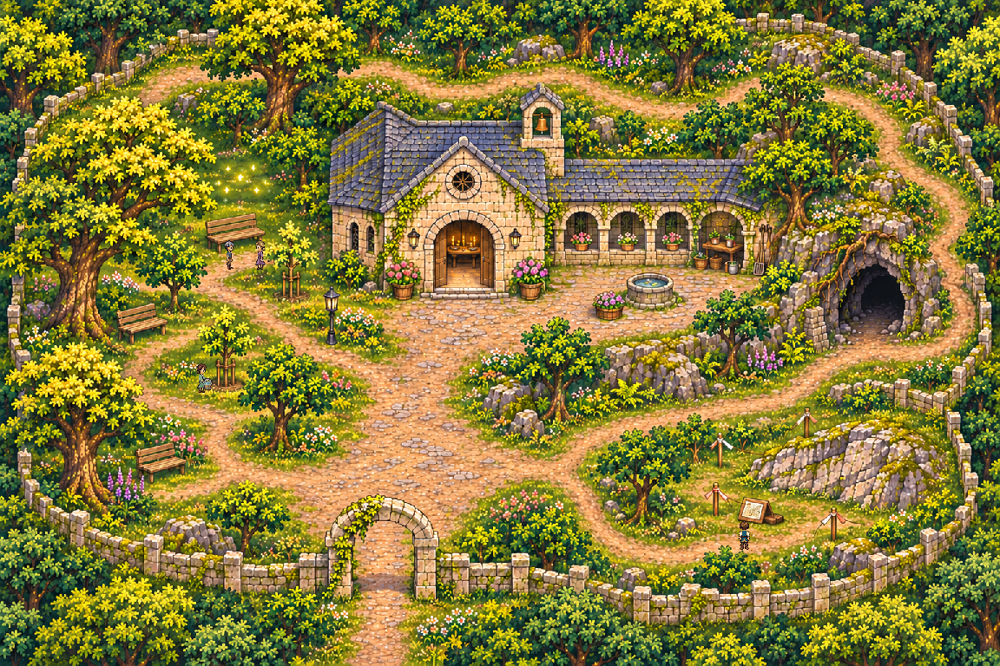

# Elden Vale Sanctuary — in-game reserve review

[Approach and reserve circuit](reserve_walk.mp4) · [Local map](local_map.png)

The capture walks normally from Eldenmere's southern exit, along the overworld
sanctuary approach and onto the miniature. It visits the boundary, caretaker,
grove visitors, confluence clearing, complete woodland loop, cave approach and
survey board, then enters the hall and reads its three observations. The hall
door and southern reserve exit return through production contacts.

Disposable save/continue checks resume inside both the reserve and hall. The
round trip ends back in Eldenmere without changing quests, inventory, dialogue
flags, abilities or music. Solid-foot probes check the hall, cliff, cave depth,
stone seam, trees, basin, benches and boundary wall. No dungeon is implemented.

[Verification](verification.json) records actual positions, inspections, map
hash and the closed walking circuit. Player save/settings files remain untouched.
Reproduce with `python tools/capture_sanctuary_reserve.py`.
