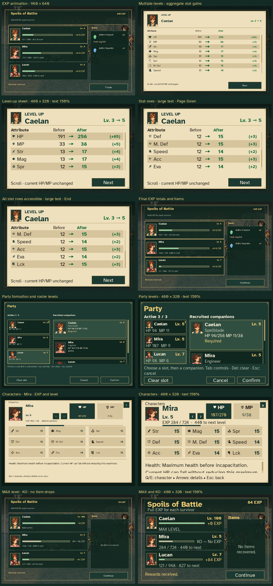

# Spoils and character progression review

These are production UI renders from a disposable, explicitly authored review
fixture. Its character levels, 840 EXP award, injury values and item quantities
are illustrative; they were not earned by playing the depicted cave encounter.
The capture never reads or changes a player's journey or settings.



The capture checks:

- Three animated character EXP rows over the actual cave battlefield.
- A combined Caelan level 3 → 5 sheet, with black old values, green arrows,
  green new values and numeric gains.
- All eleven stat rows accessible through keyboard scrolling at 150% text.
- A partial item reward when one item does not fit in inventory.
- A capped character, a KO character, and no recovered items.
- Party formation and roster levels, and Mira's Characters menu with level,
  EXP, current resources and stat details.
- Native 480 × 320 rendering at 150% text and ordinary 960 × 640 rendering.

[verification.json](verification.json) records the input plans, screenshot
dimensions and text drawn by the production renderer. The tool asserts that the
multi-level sheet is shown, old values use black, and scrolling exposes every
attribute label. Pillow only assembles the already-rendered screenshots into
the contact sheet.

Reproduce from the repository root:

```sh
SDL_VIDEODRIVER=dummy SDL_AUDIODRIVER=dummy \
  python tools/capture_spoils_progression.py
```
