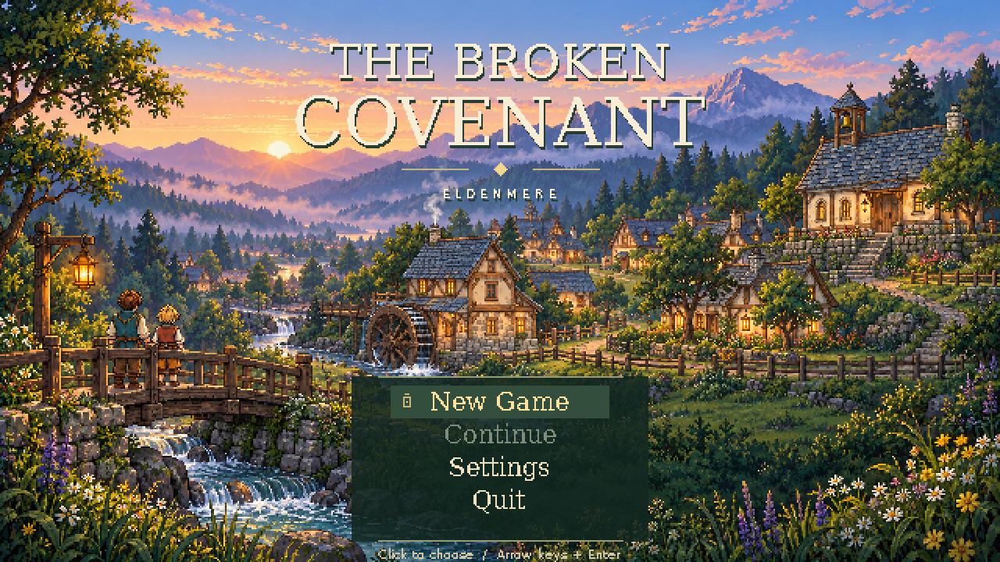

# Fullscreen title screen review

Status: awaiting user review. Launching `python main.py` opens the title screen
in fullscreen. The working title is The Broken Covenant. Menu options are
vertically stacked at the **bottom center**, as requested.



- [Animated menu, Settings and New Game transition](title_menu.gif)
- [Settings screenshot](settings.png)
- [New Game destination](new_game.png)
- [Original title music](../../../assets/ui/title/eldenmere_theme.wav)

The PNGs are exact captures from `main.Game` at 1280×720. The GIF records real
mouse hover/click and keyboard events at 5 fps, reduced to the 640×360 title
canvas and a shared 256-color palette. Frames are complete replacements with
disposal 2. Music is audible in the running game, not the GIF.

Controls:

- Hover and click an option, or use arrows/W/S and Enter/Space.
- New Game fades through black into the existing playable town. The approved
  opening bedroom story sequence is a later milestone; it is not implemented
  by this title screen.
- Continue is visibly disabled because saving is not implemented. Hovering it
  explains that no saved journey is available; clicking has no effect.
- Settings changes display mode and toggles title music, with Back/Escape to
  return. These preferences last for the current session.
- Quit exits the application. F11 remains available from title and gameplay.

Gameplay and NPC clocks do not run behind the title menu. The scene covers the
display without stretching, while UI stays inside a separately fitted safe
region on standard and wide aspect ratios. The dawn illustration follows the
approved Eldenmere art direction and contains no later-story revelations.

Reproduce:

```sh
python tools/capture_title_screen.py
python main.py --windowed
```
