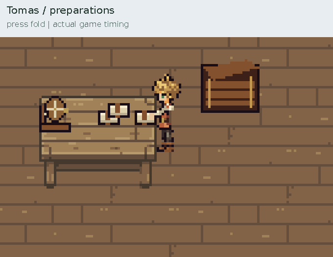
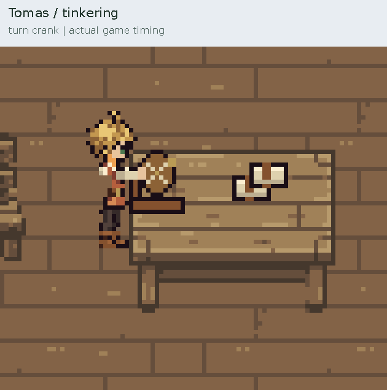
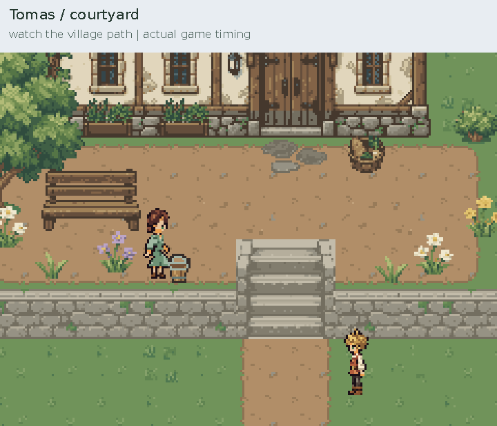

# Tomas — sanctuary routines for review

The sanctuary routines and left-side crank correction are approved and merged
into `main`. Tomas and Caelan's opening exchange is also approved; see the
[dialogue script](../../narrative/game_01/TOMAS_AMBIENT_DIALOGUE.md).

The current tinkering revision moves the crank to the wheel's left side, next
to Tomas. His hand follows the handle directly with a short bent-arm motion;
the adjustment pose also uses the near side of the wheel.

- [Full continuous in-game cycle](full_routine.mp4)
- [Prepare, lift, carry and store a bundle](preparations.gif)
- [Turn the crank, adjust it and try again](tinkering.gif)
- [Courtyard walk, glance, rest and return](courtyard.gif)
- [Close-proximity portrait dialogue](dialogue.png)

These enlarged looping previews use the actual runtime actor, scene renderer,
prop ownership and timing. The full video follows the same Tomas instance
through dining room, hall, courtyard and back. Serene and the gardener continue
their routines during capture. `capture.json` records the observed phases and
scene transitions. The captured cycle is about 74 seconds; live pauses vary.

## Routine

1. At a new table in the southwest of the sanctuary dining room, straighten a
   small linen bundle, press its fold and lift it to carry.
2. Walk to the nearby wooden storage box and place the bundle on its top.
3. Walk around to the other end of the table. Turn a small wooden wheel/crank
   model, encounter a catch, lean in to adjust it, and turn it again. The model
   is an ambient prop supporting his curiosity; it starts no quest.
4. Pause for 2.5–4.5 seconds, then walk through the hall into the courtyard.
   Doors respond to NPC proximity; Tomas waits for an opening door before
   transferring and the arrival door starts open behind him.
5. Step onto the grass beside the courtyard approach, keeping the stairs and
   path clear. Look along the path, pause for 12–20 seconds, and return indoors.
6. Fetch the stored bundle, carry it back and set it on the preparation table.
   Check the work for 1.8–3.2 seconds before repeating. The same loose bundle
   circulates; it never duplicates or respawns between stations.

The approved 24×36 idles, four-frame walks, palette, head and body proportions
remain inputs. Task frames use a 64×48 transparent canvas to accommodate nearby
work props. Joint poses move the sleeves; four carry cycles retain the approved
140 ms stride and coordinated bob. Prop/hand anchors match their room-owned
copies at each handoff. North-facing carried props sit behind his body.

Approaching Tomas closely uses the existing portrait dialogue system. If he is
carrying, he finishes the short delivery and releases the bundle before turning
to speak. If the player blocks that delivery, he can speak while holding the
bundle, keeping it in his hands throughout the conversation. Work resumes at
the paused phase when dialogue ends. The first conversation uses the approved
wheel exchange; repeat dialogue retains its existing text. The scripted opening
quest and follower segment remain separate future work.

## Reproduce and verify

```sh
python tools/build_tomas_routines.py
python tools/capture_tomas_routines.py
python -m unittest discover -s tests -q
```

The builder requires Pillow and the capture requires Pygame/Pillow plus FFmpeg.
Playing still only requires the regular game dependencies. Run `python main.py`,
enter the sanctuary and take the northeast door from the hall into the dining
room. Tomas starts at the new southwest table and follows his schedule even
while the player is elsewhere.




