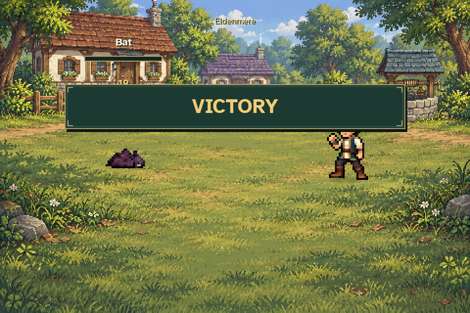
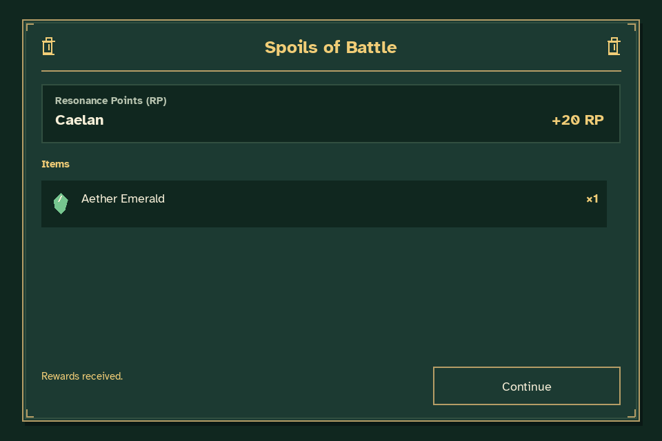
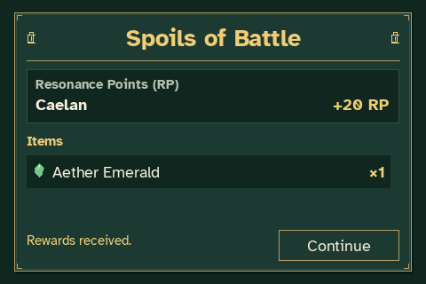

# Victory and Spoils of Battle review

[Watch victory, the fanfare and Spoils of Battle](victory_spoils.mp4).

The production Bat fight is played with Caelan's normal starting attributes and
real commands. Recording begins before the final attack. Enemy/player HP and
damage are never edited for the preview. The temporary fixture unlocks the Bat
through a legitimate completed legacy mill journey.

The last enemy's defeat starts **Triumphal Fanfare** once and shows the victory
banner. The scene then fades to a separate **Spoils of Battle** screen, where
Caelan receives 20 Resonance Points and one Aether Emerald. The fanfare reaches
its natural end, followed by 2.6 seconds of verified silence while Spoils stays
open. Continue returns to the world and its Eldenmere Theme without re-awarding.





Video frames are captured directly from the game at 960×640 and 30 FPS. SDL's
dummy audio device cannot record loopback; the MP4 soundtrack is reconstructed
offline from the exact runtime OGGs and observed production mixer commands,
including one-shot playback, fades and the natural source ending. The capture
also runs at real time during recording so the production controller observes
the actual SDL one-shot completion. Effects are muted for music review.

The [verification record](verification.json) includes reward timing, once-only
fanfare playback, natural EOF, the silent interval, mixer events and source
hashes. Temporary journey/settings files keep normal player files untouched.

Reproduce with:

```sh
python tools/capture_victory_spoils.py --output work/victory-spoils
```
