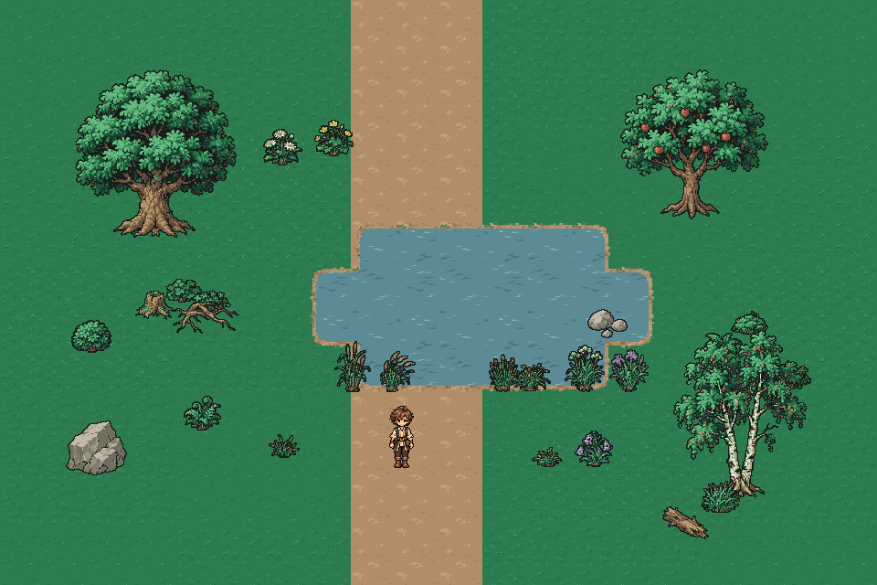
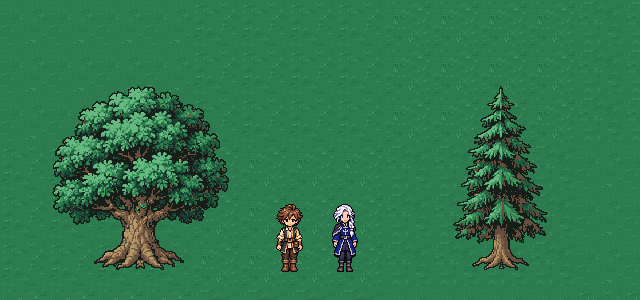

# Reusable HD vegetation and natural accents

New 2× asset bank, **not integrated into gameplay**. Visual approval remains
pending user review independently of merge status.

[Tree animation board](trees.gif) · [Small-plant animation board](small_plants.gif) ·
[Eldenmere breeze](eldenmere.gif) · [Northern woodland](northern_woodland.gif) ·
[Wetland](wetland.gif)

The bank contains 51 new designs across 17 families, three distinct silhouettes
per family. Twelve trees cover broadleaf, slender woodland, orchard and conifer
forms, including asymmetric, sparse and weathered variants. Fifteen ground plants
cover shrubs, ferns, grass clumps, flowers and groundcover. Nine waterside designs
cover tall reeds, rushes and flowering bank plants. Fifteen static accents cover
boulders, rock clusters, fallen logs, stumps and exposed roots.

Family boards:

- [Broadleaf](families/broadleaf.png), [woodland](families/woodland.png),
  [orchard](families/orchard.png), [conifer](families/conifer.png).
- [Shrubs](families/shrub.png), [ferns](families/fern.png),
  [grass](families/grass.png), [flowers](families/flowers.png),
  [groundcover](families/groundcover.png).
- [Tall reeds](families/tall_reeds.png), [rushes](families/rushes.png),
  [flowering banks](families/bank_flowers.png).
- [Boulders](families/boulder.png), [rock clusters](families/rock_cluster.png),
  [fallen logs](families/fallen_log.png), [stumps](families/stump.png),
  [exposed roots](families/exposed_roots.png).

Four retained new source drawings supply the art. Leaves use the shared emerald
palette, with established bark/stone colors and explicit birch, flower and fruit
accents. Hard-alpha silhouettes have thin dark contours and padded canvases.
The native tree canvas retains 96×120 logical units at 192×240 artwork pixels;
small plant sizes and taller reed registration retain their established scale.
The common-baseline comparison preserves the original approved character pixels.

Living foliage has a restrained nine-frame, 5.4-second breeze. Tree trunks, roots,
branches and crown coverage stay fixed while local source-derived leaf clusters
rustle horizontally by at most one artwork pixel. Small plants bend above their
fixed bases; roots and occupied heights stay registered. Rocks and deadwood remain
static. Each design has an explicit idle for reduced-motion presentation.

The three regional fixtures are offline asset compositions using the staged ground
and water banks. Water is held still to expose vegetation movement. Plants are
grounded by recorded roots and sorted by ground depth; groundcover/root overlays
sit below actors. These are illustrative layouts, not canonical map changes.
Existing shared interactive grass and its contact/parting/recovery behavior are
unchanged; the new grass clumps are decorative assets pending explicit integration.

Validation: 14 focused tests cover family inventory and distinct silhouettes,
logical/artwork sizing and anchors, legacy scale contracts, named palettes, hard
alpha and canvas margins, native fine detail, thin contours, sheet/atlas
reconstruction, fixed roots/trunks, bounded horizontal motion and loop registration,
source-layer reconstruction, exact GIF/PNG timing and pixels, scene reconstruction
and depth ordering, explicit non-registration, hashes and deterministic scoped
exports. The tests also verify the complete output inventory.
Visual review covers individual boards, native/enlarged assets, character scale,
root placement, ground/water contrast and restrained motion.

`layout.json` records terrain, placements, phases and references. The PNG frame
directories retain native pixels; GIFs use one exact common palette per sequence,
with held frames allowed to coalesce only when timing and decoded pixels match.
`exports.json` records source/recipe/output hashes. `preservation.json` records a
one-time comparison of ten existing banks, maps and approved characters; it does
not freeze unrelated future development. No active map, collision, navigation,
renderer, save state or contact system is changed.

All creation and maintenance guidance remains in the
[terrain standard](../../TERRAIN_ART_STANDARD.md#staged-world-hd-vegetation-and-natural-accents).
