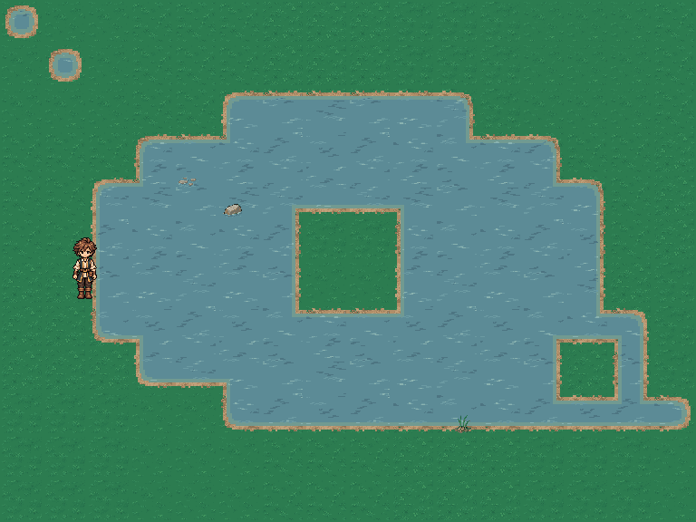
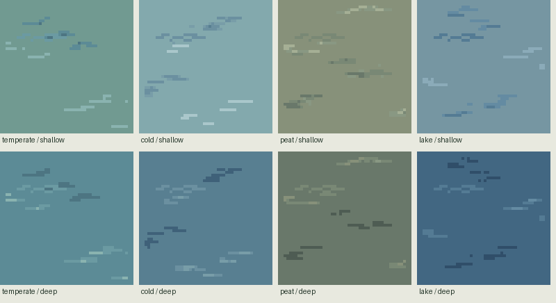
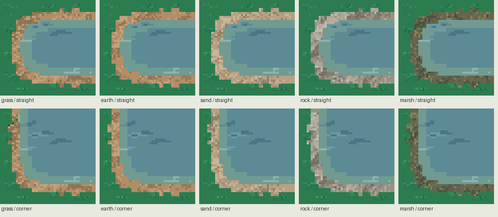

# HD world water and natural shores

Staged 2× artwork, **not integrated into gameplay**. Visual approval remains
pending user review independently of merge status.

[Temperate animation](eldenmere.gif) · [Cold mountain water](mountain.gif) ·
[Lake and sandy banks](lake.gif) · [Marsh](marsh.gif) ·
[Broad repeated water field](repeated_water.gif)

[Grass shapes](blob_grass.png) · [Earth](blob_earth.png) · [Sand](blob_sand.png) ·
[Rock](blob_rock.png) · [Marsh](blob_marsh.png)

The retained new source drawings supply four water families and five shoreline
materials. Each water family has shallow/deep treatments, two arrangements and
four spatial phases, with six 200 ms animation frames and an explicit static
alternative. Each shoreline family has 47 shapes and two compatible arrangements.
Separate coverage, shallow margins, depth controls and bank-material selectors
allow reuse without baking every water/bank combination into another atlas.

Twenty-four directional current overlays and four local ripple/eddy/foam/impact
loops supplement nine drawn accent sprites. Twelve bank-material junction atlases
cover six supported pairs in both axes. Other pairings, open ocean surf, ice,
magical water and full tall-vegetation reconstruction remain future work.

The offline scenes show broad water, islands, enclosed openings, narrow branches,
isolated/diagonal patches, bank variation and approved native-density Caelan.
Repeated source texture uses a four-tile spatial field; material arrangements are
chosen in coherent groups. The bank silhouettes and broad base material remain
fixed while localized ripples animate. Large pools remain quiet behind actors.
Rooted plants are grounded on shoreline margins; submerged and emergent rocks are
separate decorations. These are illustrative fixtures, not new canonical maps.

Validation: 12 focused tests pass. Checks cover 256 neighborhood lookups, retained
logical coverage, disjoint land/water and water-contained shallow margins, 2,048
geometrically compatible neighbor cases across every bank arrangement pairing,
quarter/atlas reconstruction, all surface-frame ports, stable bases and static
alternatives, named palettes/native detail, mixed-material junction reconstruction,
current/effect movement, exact GIF/PNG pixels and 1.2-second timing, hashes and
reproducible exports scoped to the new bank/review directory.

`layout.json` records fixtures and references. The PNG frame directories retain
native pixels; GIFs use a common exact palette. `exports.json` records source,
recipe and output hashes. `preservation.json` is a one-time existing-bank check,
not a permanent restriction on future development. Existing maps, assets,
renderers, collision, navigation and save data are unchanged.

All authoring/maintenance guidance remains in the
[terrain standard](../../TERRAIN_ART_STANDARD.md#staged-world-hd-water-and-natural-shores).
